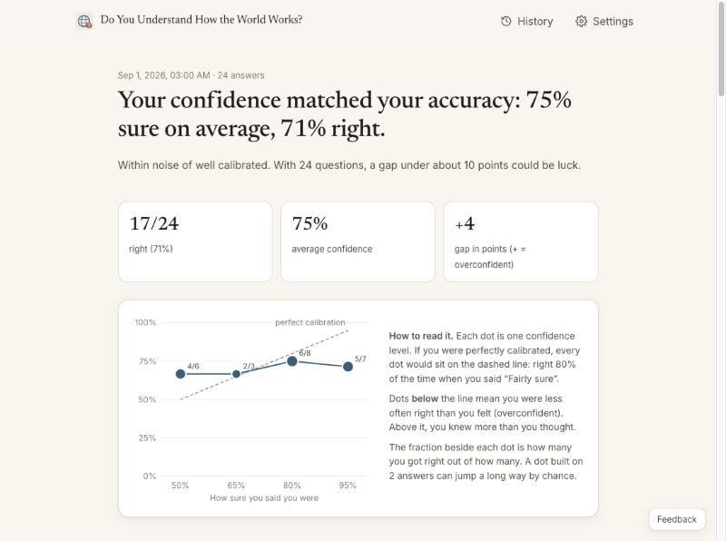
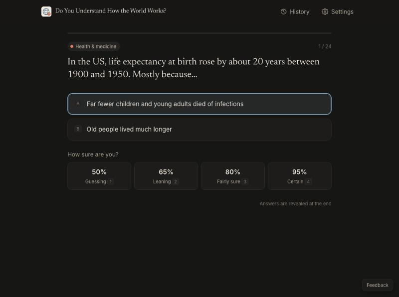
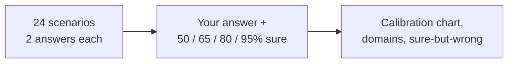

# Do You Understand How the World Works?

24 short real-world scenarios about health, politics, work and people. Guess your score, pick answers, say how sure you are, then take a second look with new evidence. See where your confidence matches reality and whether you weigh evidence by its quality. Every answer links to its source.

**[Take it →](https://amalmehta.github.io/DoYouUnderstandHowTheWorldWorks/)**

| Results (light) | A question (dark) |
|---|---|
|  |  |

- [How to run and use it](docs/INSTRUCTIONS.md)
- [System design](docs/SYSTEM-DESIGN.md) · [File structure](docs/FILE-STRUCTURE.md) · [Manual review checklist](docs/MANUAL-REVIEW.md)
- [Prompt log](docs/PROMPTS.md)

Answers stay in your browser. No accounts, no tracking.
