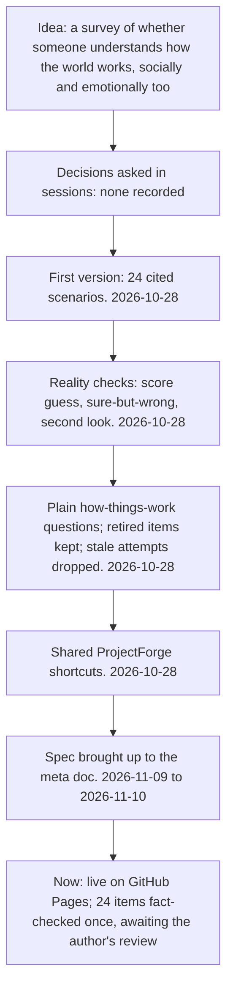
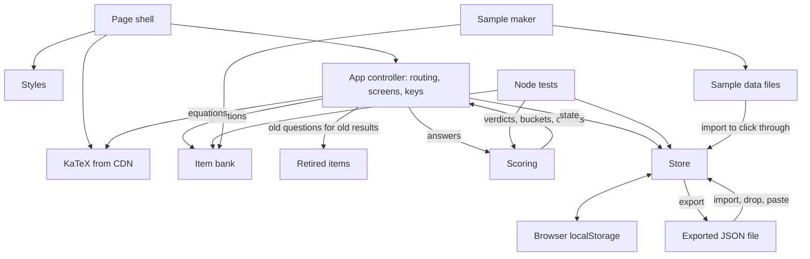
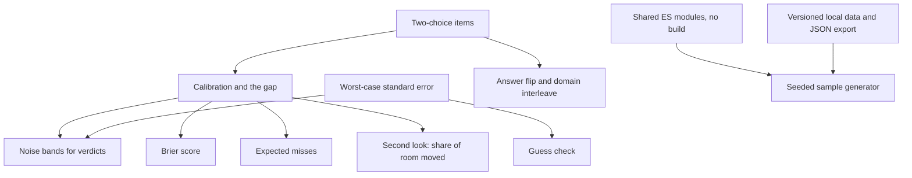

<!-- ProjectForge explainer at 9d8c4a5 -->
# How DoYouUnderstandHowTheWorldWorks? was built

It is a one-page web quiz. You answer 24 two-choice questions about how health, government, money and people really work, and for each one you say how sure you are. It is for anyone who wants to check whether their picture of the world, including the social and emotional parts, matches the evidence. The key idea is to measure **calibration** rather than just the score: do your "80% sure" answers turn out right about 8 times in 10?

## Build history

- **First version (2026-10-28).** A calibration test with 24 cited scenarios. It turns the idea into something measurable: answer, say how sure you are, then compare that with reality.
- **Reality checks (2026-10-28).** Added three more checks: guessing your score up front, comparing how many "sure" answers were wrong with how many your confidence predicted, and a second look where new strong or weak evidence is shown. These cover how you judge yourself and how you respond to evidence, not only what you know.
- **Plain questions (2026-10-28, two commits).** The study-style items were replaced with plain questions about how things work. The old ones moved to `js/items-retired.js` so past results still show (its header says they "read like study trivia"). A second commit drops any unfinished attempt that still points at retired questions, so the next start uses the current set (`js/app.js:12-18`).
- **Shared shortcuts (2026-10-28).** Added the shared ProjectForge shortcuts (`Shortcuts.md`) and pointed the project instructions (`CLAUDE.md`) at them.
- **Spec catch-up (2026-11-09 to 2026-11-10, two commits).** Brought the spec up to date with the current meta doc, added the shared shortcuts, then added the meta doc's line about fitting how people naturally interact with the world.

## Code map

| Part | File | What it does |
|---|---|---|
| Page shell | `index.html` | Holds the header, the `#view` container, the settings and feedback dialogs and a hidden file input. It also applies the saved theme before first paint and loads KaTeX and `js/app.js`. |
| Styles | `css/style.css` | Layout, light and dark themes, reduced motion, domain colours. |
| App controller | `js/app.js` | Hash routing, the home, question, results and history screens, keyboard handling, import and export UI, settings. |
| Item bank | `js/items.js` | `DOMAINS` and the 24 `ITEMS`. Each item has a prompt, two options with the correct one first, a why, a principle and a source. Six items also carry `evidence`. |
| Retired items | `js/items-retired.js` | `RETIRED`: the replaced items. They are never asked again but stay available so older attempts can still be displayed. |
| Scoring | `js/scoring.js` | Pure functions with no DOM: `score`, `verdict`, `headline`, `guessCheck`, `secondLook`, `maxSE`. |
| Store | `js/store.js` | `load` and `save` to localStorage under the key `dyuhtww.v1`; `exportData`, and `importData` with validation and de-duplication. |
| Node tests | `tests/*.test.mjs` | Run by `npm test` (`node --test`). They cover scoring, reality checks, item-bank integrity and import/export. |
| Sample maker | `tests/make-samples.mjs` | Writes importable attempt files from a seeded random generator (`npm run samples`). |
| Sample data | `tests/sample-data/*.json` | Files you can import (calibrated, overconfident, deferrer, corrupt, wrong app and more) to click through the UI. |

## Concepts

**Two-choice items.** Every item has exactly two options, and `options[0]` is always the correct one. With two options, a pure guess is right 50% of the time, so the lowest confidence level, "Guessing", truly means 50% and the chart's diagonal is a fair yardstick. Correctness is simply `choice === 0`. Shuffling only changes the screen order, never the stored choice. Lives in `js/items.js:1-4` and `js/app.js:211`.

**Calibration and the gap.** You are calibrated if, across all the times you say "p sure", you are right a share p of the time. The app offers four levels: 0.5, 0.65, 0.8 and 0.95 (`CONFIDENCE`). It then reports the gap: average confidence minus accuracy, where a positive gap means overconfident. It also groups answers by level into "buckets" and plots each bucket's hit rate against the diagonal. Lives in `js/scoring.js:3-8, 24-55` and the chart in `js/app.js:253-268` (`chartSVG`).

**Worst-case standard error.** A standard error is how much a measured share moves around by chance. For a share over n yes/no items it is $\sqrt{p(1-p)/n}$. That value is largest at p = 0.5, so the code uses that upper bound without having to estimate p:

$$\mathrm{SE}_{\max} = \sqrt{\frac{0.25}{n}}$$

For 24 items this is about 0.10 (10 points); for a 6-item domain it is about 0.20. Lives in `js/scoring.js:11` (`maxSE`).

**Noise bands for verdicts.** `verdict(gap, n)` compares |gap| with SE. Within 1 SE the verdict is "within noise" ("too few items to tell" if n < 10). Between 1 and 2 SE it is "probably over/underconfident", and beyond 2 SE it is "clearly". This keeps a small sample from being read as a strong claim. Lives in `js/scoring.js:14-22`. The results screen states the threshold in plain points (`js/app.js:360, 384`).

**Guess check.** Before the questions, you guess how many you will get right. The same worst-case idea is applied to a count rather than a share: a count of n coin-flip items wobbles by about $\sqrt{0.25\,n}$, which is about 2.4 for 24 items. A miss within 1 of those is "about right", 1 to 2 is "somewhat above/below", and more than 2 is "well above/below". Lives in `js/scoring.js:77-86` (`guessCheck`).

**Brier score.** This is the average squared distance between your confidence and the outcome. Lower is better.

$$B = \frac{1}{n}\sum_{i=1}^{n}(p_i - o_i)^2$$

Here $p_i$ is your confidence in the answer you picked and $o_i$ is 1 if that answer was right, 0 if wrong. That gives the same result as the usual form based on the probability you put on the correct answer: if you were wrong, that probability is $1-p_i$, and $(1-p_i-1)^2 = p_i^2$. Always saying "Guessing" scores 0.25. Lives in `js/scoring.js:30`; it is explained on the results page at `js/app.js:403-407`.

**Expected misses.** Take the answers you rated 0.8 or higher. Your own confidence predicts that $\sum (1 - p_i)$ of them will be wrong. The app shows that number next to the actual count of wrong answers (`sureButWrong`). Many more misses than predicted is the clearest sign of holding beliefs too firmly. Lives in `js/scoring.js:53` and `js/app.js:291-292` (`realityChecks`).

**Second look: share of room moved.** This is the hard part. Six items carry `evidence`: three `strong` snippets that point to the right answer, and three `weak` ones that are true but point to the wrong answer. After the main round you see each of those six items again with its snippet and answer again. To compare answers, the code first converts each one to q, the probability you put on the correct answer: q = p if you picked option 0, otherwise 1 − p. Movement is then measured as a fraction of how far you *could* have moved, so someone already at 95% is not penalised for having nowhere to go:

$$\text{share}_{\text{strong}} = \frac{q_1 - q_0}{0.95 - q_0} \qquad \text{share}_{\text{weak}} = \frac{q_0 - q_1}{q_0 - 0.05}$$

The share is clamped to [−1, 1]. It is skipped (null) when the room is 0.001 or less. The app averages the shares for each kind of evidence and maps the pair to a pattern. Strong ≥ 0.5 and weak ≤ 0.25 is "weighs". Both high is "defers", both low is "sticks", and the reverse is "backwards". The cut-offs are marked "editorial, not validated" in the code, and with only three items per kind, one answer can flip the pattern. Lives in `js/scoring.js:93-119` (`secondLook`, `MOVE_CUTOFFS`), with data collection in `js/app.js:140-148, 212-216`.

**Answer flip and domain interleave.** When an attempt starts, each item gets a random `flip`, so the correct answer is not always shown first. It is turned off by the "Shuffle answer order" setting. The item order comes from `itemOrder`. It shuffles each domain's pool (a Fisher–Yates shuffle, `shuffled`) and shuffles the domain order once. It then takes one item from each domain in turn, so two questions from the same domain never sit next to each other. One side effect: after the first four questions, the domain sequence repeats in the same order. Lives in `js/app.js:34-47, 112-118, 169`.

**Versioned local data and JSON export.** All state is a single JSON object in localStorage: `attempts`, `inProgress` and `settings`. Each attempt stores raw choices and item IDs, not totals, so results are re-scored from scratch every time they are viewed. That is why retired items must stay findable (`ITEM_BY_ID` merges `RETIRED` and `ITEMS`, `js/app.js:8`). An export file carries `app` and `version` fields. Import does the following:
- rejects files from another app or from a newer version;
- drops attempts that fail `isAttempt`, for example a bad date or a confidence outside 0.5 to 1;
- skips IDs it already has;
- sorts the result by date.

Lives in `js/store.js`.

**Shared ES modules, no build.** The browser loads `js/app.js` as a native module (`index.html:78`). `scoring.js`, `store.js` and `items.js` never touch the DOM, so Node's built-in test runner imports the same files directly (`package.json`, `tests/*.test.mjs`). `store.js` takes the storage object as a parameter (`load(storage = globalThis.localStorage)`). Tests can therefore pass a fake storage, including one that throws, which mimics private browsing mode.

**Seeded sample generator.** `tests/make-samples.mjs` uses the Park–Miller "minimal standard" generator, $x \leftarrow 16807\,x \bmod (2^{31}-1)$, seeded with 7. Each run therefore writes the same files. Each sample person is defined by:
- a confidence picker;
- a hit-rate function, for example right 55% of the time while always saying 0.8 or 0.95;
- how they respond to evidence: `weighs`, `defers` or `sticks`.

The files use `APP_ID` and `FORMAT_VERSION` from `js/store.js`, so they import cleanly.

## One input, start to finish

The input: a person takes the test, reaches item `s3` ("You just had a first conversation with someone new… they probably liked you…"), picks "More" at "Fairly sure", and later moves to "Certain" when shown the strong evidence.

1. **Page load.** `index.html` runs its inline script, which reads `dyuhtww.v1` from localStorage and applies the saved theme before first paint. `js/app.js` then calls `load()` (`js/store.js`). It clears any `inProgress` attempt whose `order` contains retired IDs, and `render()` shows `renderHome()`.
2. **Start.** Clicking Start (or pressing Enter) calls `startAttempt()` in `js/app.js`. It builds the order with `itemOrder()`, rolls a `flip` for each item, saves `inProgress` through `persist()` → `save()`, and calls `go("#item")`.
3. **Guess.** The `hashchange` event calls `render()` → `renderItem()`. `phase()` returns `"guess"` because `guess` is not set yet, so `renderGuess()` asks for a whole number from 0 to 24. Submitting the form calls `setGuess()`, which validates and stores it, say 18.
4. **Question s3.** When `s3` comes up, `renderItem()` finds it through `ITEM_BY_ID` and calls `renderQuestion()`. If `flip.s3` is true, "Less" appears as A and "More" as B. Each button's `data-choice` still holds the true option index.
5. **Choice.** Clicking "More" (or pressing its letter) triggers the document click/keydown handler, which calls `choose(0)`. That sets `pending = { choice: 0 }` and reveals the confidence row.
6. **Confidence.** Pressing 3 calls `confide(0.8)`. It pushes `{ id: "s3", domain: "people", choice: 0, correct: true, p: 0.8, ms }` onto `inProgress.answers`, calls `persist()`, and calls `renderItem()` again after 140 ms. Closing the tab now loses nothing.
7. **Second look.** After the 24th answer, `phase()` returns `"second"`. `renderItem()` builds `inProgress.second.order` from the six answered items that have `evidence`, shuffled, and `s3` is one of them. `renderQuestion()` is called again with the first answer, so it shows "Your first answer: More · Fairly sure" and the Boothby et al. snippet. Choosing "More" at "Certain" makes `confide(0.95)` push `{ id: "s3", kind: "strong", before: { choice: 0, p: 0.8 }, after: { choice: 0, p: 0.95 } }`.
8. **Finish.** When all six are done, `finishAttempt()` builds an attempt containing `id`, `date`, `guess`, `answers` and `secondLook`, adds it to `state.attempts`, clears `inProgress`, saves, and calls `location.replace("#results/<id>")`.
9. **Scoring.** `renderResults()` calls `score(attempt.answers)` (`js/scoring.js`). The s3 answer is counted in four places:
   - the 0.8 bucket;
   - the `people` domain summary, which gets its own `verdict`;
   - the Brier sum, adding (0.8 − 1)² = 0.04;
   - not `sureButWrong`, because it was right.

   `headline()` turns the overall result into the opening sentence.
10. **Reality checks.** `realityChecks()` calls `guessCheck(18, correct, 24)`, adds up the expected misses over answers with p ≥ 0.8, and calls `secondLook(attempt.secondLook)`. For s3, q₀ = 0.8 and q₁ = 0.95, so room = 0.15, moved = 0.15 and share = 1.0. That share is averaged with the other two strong items.
11. **Display.** `chartSVG()` draws the buckets against the diagonal. `reviewItem()` lists s3 with its why, its principle and a source link, and `secondLookReview()` shows s3 as "S … kept". `typeset()` hands the two `data-tex` equations to KaTeX, or leaves them as plain text if KaTeX failed to load.
12. **Export.** "Export results" calls `doExport()` → `exportData()` (`js/store.js`). This downloads `World Works results YYYY-MM-DD.json` with `app`, `version: 1` and all attempts. Dropping or pasting that file in another browser runs `importData()`, which validates it, removes duplicates and sorts by date.

## Where this came from

Written from the spec, the decisions (none recorded), the git history and the code as of commit `9d8c4a5` (2026-11-10).
