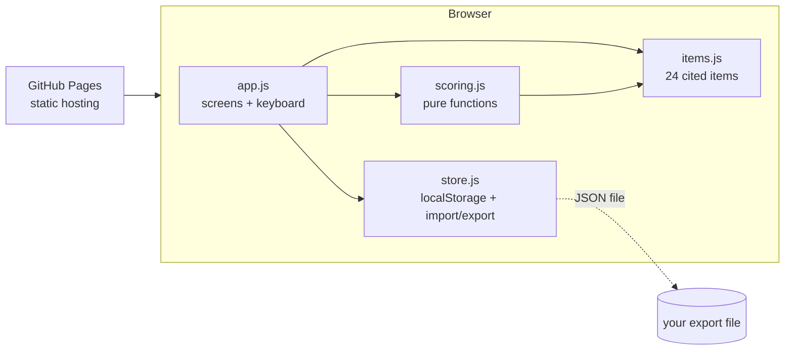

# System design

**What it is.** A 24-item calibration test that runs as one static web page. Each item is a plain question about how something works (healthcare, budgets, money, people), with two answers. You pick one and say how sure you are. At the end it shows where your confidence matched reality and where it didn't, by domain, with the source behind every answer.

**Who it's for (v1).** One person, the author, using it as a mirror for blind spots. Anyone with the link can take it, but nothing is designed for comparing people or screening them.

## Architecture

There is no server, no account and no network call after the page loads (KaTeX for the one equation comes from a CDN; if it fails, the formula shows as plain text).

| Piece | Job | Interface |
|---|---|---|
| `js/items.js` | The item bank: prompt, two options (correct first), why, principle, source | `ITEMS`, `DOMAINS` |
| `js/scoring.js` | Turns answers into accuracy, calibration, Brier score and verdicts. No DOM, so it's testable in Node | `score(answers)`, `verdict(gap, n)`, `CONFIDENCE` |
| `js/store.js` | Reads/writes attempts and settings; validates imports | `load()`, `save()`, `exportData()`, `importData(text)` |
| `js/app.js` | Screens (home, item, results, history), settings, feedback, file drop/paste | DOM only |

## Main flows

1. **Take it.** Home → Start → guess your score (0–24) → 24 items, one per screen. Choose an answer (A/B or click), then confidence (1–4). It moves on as soon as you pick a confidence. Progress is saved after every item, so closing the tab resumes where you were.
2. **Second look.** The 6 items that carry `evidence` come back, each with one new piece of information (3 strong, pointing to the right answer; 3 real but weak, pointing to the wrong one). You answer again. These answers never change the main score.
3. **Results.** One plain sentence, the calibration chart, three reality checks (guess vs score, sure but wrong, second look), the four domains, then "Sure but wrong" items expanded first, then the second look answer by answer. Every item can be opened for the why, the general principle and the source.
4. **History.** Past attempts are listed with their overconfidence. Export saves a JSON file; Upload, drag-anywhere or ⌘V brings one back.

## Scoring (definitions)

See the spec's DEFINITIONS section; the code in `scoring.js` is the source of truth.

- **Confidence levels**: Guessing 50%, Leaning 65%, Fairly sure 80%, Certain 95%.
- **Accuracy** = correct ÷ answered.
- **Overconfidence gap** = mean stated confidence − accuracy (percentage points). Positive = overconfident.
- **Verdict**: let SE = √(0.25 / n), the largest standard error a proportion of n items can have. |gap| ≤ 1 SE → "within noise"; 1–2 SE → "probably over/underconfident"; > 2 SE → "clearly". For 24 items, 1 SE ≈ 10 points; for a 6-item domain, ≈ 20 points.
- **Guess check**: guess − correct, judged against √(0.25·n) ≈ 2.4 items: within 1 → about right, 1–2 → somewhat, beyond 2 → well above/below.
- **Sure but wrong vs expected**: count of wrong answers rated ≥ 80%, next to Σ(1 − p) over those answers (the misses your own confidence predicted).
- **Second look**: q = probability you put on the correct answer. For strong evidence, share moved = (q_after − q_before) / (0.95 − q_before); for weak, (q_before − q_after) / (q_before − 0.05). Skipped when there was no room to move. Patterns: strong ≥ 50% and weak ≤ 25% → weighs evidence; both high → defers; both low → sticks; reversed → backwards. Cut-offs are editorial, not validated; 3 items each.
- **Brier score** = mean of (p − o)², where p is your confidence in the answer you picked and o is 1 if right, 0 if wrong. 0 is perfect; always saying "Guessing" scores 0.25.

## Key decisions and trade-offs

- **Two options, not four.** With two options, "Guessing" really means 50%, so the chart's diagonal is honest. Cost: a lucky guess is right half the time, so per-item results are noisy. That's why verdicts use SE thresholds.
- **No "delusional" label.** The author asked whether the test could gauge whether someone is "actually delusional". A quiz can't diagnose a clinical delusion, so the test reports three behaviours instead (overestimating your score, being sure but wrong, how you respond to evidence) and calls none of them a diagnosis.
- **Weak evidence is real, not invented.** Each weak snippet is true and sourced but weak for the question asked: an opinion poll, an older and coarser study, a fact about a later stage. That's what lets the round tell weighing evidence apart from deferring to it, without fabricating anything.
- **Answers revealed only at the end.** Seeing answers mid-way would teach you to adjust and muddy the calibration reading. Cost: less instant feedback.
- **Hand-written, cited items rather than AI-generated ones.** AI-written questions could cite sources that don't say what they claim. Cost: a fixed bank of 24, so retakes partly test memory (noted in limits).
- **No framework, no build step.** Plain ES modules. A static page needs none, and nothing breaks when a dependency updates.
- **localStorage, not a server.** One user, a few KB per attempt. Export/import covers backups and moving devices.
- **Domains grouped into two hue families.** Health and People (about people and bodies) share warm terracotta shades; Politics and Work (about systems) share muted blues.

## Testing

- `npm test` (Node's built-in runner, no dependencies): scoring on sample answer sets (calibrated, overconfident, underconfident, all right, all wrong, empty), verdict thresholds, item-bank integrity (24 items, 6 per domain, two options, a source URL each), and import validation (good file, corrupt JSON, wrong shape, duplicates).
- `tests/sample-data/*.json` are importable attempt files for clicking through the UI.
- `docs/MANUAL-REVIEW.md` lists what tests can't check: feel, smoothness, dark mode, phone layout.

## Known limits

- The second look has only 3 strong and 3 weak items, so its pattern is a hint, not a measurement. Showing the strong snippets for the right answer may teach takers to trust the app; that's why half the snippets point the other way.
- 24 items is a small sample. Per-domain numbers are mostly "too few to tell" by design.
- Some items are famous (e.g. the screening test). Anyone who knows them scores better without understanding more.
- The items test whether you know well-replicated findings and base rates. That isn't the same as handling your own emotions well in the moment, which no multiple-choice item can measure.
- Item answers come from published research. Some findings may be revised over time; each source is linked so you can check.

## What would change at larger scale

| If… | Then… |
|---|---|
| Retakes matter | Grow the bank to ~100 items and draw 24 per sitting, balanced by domain |
| Others take it and you want aggregate results | A small backend (e.g. a single serverless function + SQLite) with anonymous submissions and a privacy note |
| Thousands of takers | Item statistics (difficulty, discrimination) to drop items that don't separate people |
| Other languages | Move item text into per-locale JSON |

## Ten steps ahead

1. v1: 24 items, local results (this build). 2. Author reviews every item and fixes or cuts. 3. Take it, retake after a month, see if the gap moved. 4. Bigger bank with random draws. 5. Per-item "what most people answered" once there's data. 6. Optional anonymous sharing of a result card. 7. A Mac wrapper only if daily use justifies it. 8–10. Item statistics, adaptive difficulty, translations.

Choices made now to keep those easy: items are data, not code; scoring is pure and separate from the UI; stored attempts keep item IDs and raw choices (not just totals), so results can be re-scored after items change; the export format has a version number.
